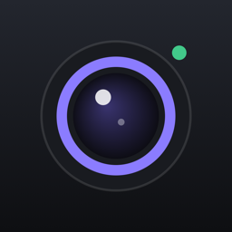

<h1 align="center">LumaCam</h1>

Use your iPhone as a professional webcam on Windows. Local, encrypted, low latency. 
iPhone'unuzu Windows'ta profesyonel bir web kamerası olarak kullanın. Yerel, şifreli, düşük gecikmeli.

<a href="https://github.com/xdlips/LumaCam/releases/latest"><b>⬇ Download LumaCam Studio for Windows</b></a>

> [!WARNING]
> **Alpha.** Early test releases. The iPhone app is tested on real hardware; LumaCam Studio for Windows is built
> and tested automatically on Windows, but hasn't been tested much with real hardware yet. Please report problems in
> [Issues](https://github.com/xdlips/LumaCam/issues).
>
> **Alfa sürüm.** Erken test sürümleri. iPhone uygulaması gerçek cihazda test edildi; Windows uygulaması otomatik olarak
> Windows üzerinde derlenip test ediliyor ancak henüz gerçek donanımla yeterince denenmedi.

---

## English

### What you get
- **LumaCam for iPhone**: streams the iPhone camera (wide, ultra wide, telephoto, front) as hardware H.264, up to 4K.
- **LumaCam Studio for Windows**: live preview, full remote camera control (zoom, exposure, focus, white balance,
  torch, resolution, frame rate, quality), live statistics, and **LumaCam Virtual Camera**, a real Windows camera
  you can pick in OBS, Teams, Zoom, Discord, Meet and browsers.
- No account, no cloud, no recording. Video never leaves your local network.

### Requirements
| | |
|---|---|
| PC | Windows 11 (64-bit) for the virtual camera. Windows 10 1809+ shows the preview only. |
| iPhone | iOS 18 or later |
| Network | iPhone and PC on the same Wi-Fi/LAN (guest networks that isolate devices won't work) |

### Install on Windows
1. Download `LumaCamStudio-Setup-<version>-x64.exe` from [Releases](https://github.com/xdlips/LumaCam/releases).
2. Run it. Windows SmartScreen may warn because the installer isn't code-signed yet: click **More info → Run anyway**.
   You can check the file against `SHA256SUMS.txt` from the same release:
   `Get-FileHash .\LumaCamStudio-Setup-*.exe -Algorithm SHA256`.
3. Allow the administrator prompt. The installer registers the virtual camera and adds a firewall rule limited to
   *private* networks.
4. Open **LumaCam Studio**. When Windows asks about network access, allow **Private networks**.

A portable zip is also attached to each release (no installer). To use the virtual camera from it, choose
**Set up virtual camera** in the title bar once and allow the Windows permission prompt. If you move or delete the
folder later, Studio asks you to set it up again. Portable copies don't update themselves; download the new zip.

### Install on iPhone
The iPhone app is distributed through **TestFlight** (link coming soon in the release notes) and later the App
Store. Apple doesn't allow installing iPhone apps directly from GitHub.

### Pair and use
1. In Studio: **Connection → Show Pairing Code**.
2. In LumaCam on the iPhone: tap the **QR** button and scan the code. It's valid for 2 minutes and works once.
3. The video appears in Studio. Use the right-hand panel to control the camera.
4. In OBS/Teams/Zoom, choose **LumaCam Virtual Camera**. Next time, just open both apps; they reconnect automatically.

### Updates
Studio checks this page for new versions automatically (Settings → Updates; can be turned off). **Update Now**
downloads the installer, verifies its SHA-256 checksum, and installs it. The iPhone app shows when a new version
exists; install it through TestFlight or the App Store.

### Privacy
See [PRIVACY.md](PRIVACY.md). In short: local only, encrypted, no analytics. The only internet request is the
optional anonymous update check.

### Troubleshooting
See [TROUBLESHOOTING.md](TROUBLESHOOTING.md). Every error shows a code like `LC-NET-002`. Include it when you open
an issue.

---

## Türkçe

### Neler var
- **iPhone için LumaCam**: iPhone kamerasını (geniş, ultra geniş, telefoto, ön) donanım H.264 ile 4K'ya kadar yayınlar.
- **Windows için LumaCam Studio**: canlı önizleme, kameranın uzaktan tam kontrolü (zoom, pozlama, odak, beyaz
  dengesi, fener, çözünürlük, FPS, kalite), canlı istatistikler ve OBS, Teams, Zoom, Discord, Meet ile tarayıcılarda
  seçebileceğiniz gerçek bir Windows kamerası olan **LumaCam Virtual Camera**.
- Hesap yok, bulut yok, kayıt yok. Görüntü yerel ağınızdan dışarı çıkmaz.

### Gereksinimler
| | |
|---|---|
| Bilgisayar | Sanal kamera için Windows 11 (64-bit). Windows 10 1809+ yalnızca önizleme gösterir. |
| iPhone | iOS 18 veya üstü |
| Ağ | iPhone ve bilgisayar aynı Wi-Fi/yerel ağda (cihazları birbirinden yalıtan misafir ağları çalışmaz) |

### Windows'a kurulum
1. [Releases](https://github.com/xdlips/LumaCam/releases) sayfasından `LumaCamStudio-Setup-<sürüm>-x64.exe` dosyasını indirin.
2. Çalıştırın. Kurulum dosyası henüz kod imzalı olmadığı için Windows SmartScreen uyarı verebilir:
   **Ek bilgi → Yine de çalıştır** deyin. Dosyayı aynı sürümdeki `SHA256SUMS.txt` ile doğrulayabilirsiniz:
   `Get-FileHash .\LumaCamStudio-Setup-*.exe -Algorithm SHA256`.
3. Yönetici iznini onaylayın. Kurulum, sanal kamerayı kaydeder ve yalnızca *özel* ağlar için bir güvenlik duvarı kuralı ekler.
4. **LumaCam Studio**'yu açın. Windows ağ erişimi sorarsa **Özel ağlar** seçeneğine izin verin.

Her sürümde kurulum gerektirmeyen taşınabilir bir zip de var. Önizlemeyi gösterir ama sanal kamerayı **kaydedemez**.

### iPhone'a kurulum
iPhone uygulaması **TestFlight** üzerinden (bağlantı yakında sürüm notlarında), ileride App Store'dan dağıtılacak.
Apple, iPhone uygulamalarının GitHub'dan doğrudan kurulmasına izin vermiyor.

### Eşleştirme ve kullanım
1. Studio'da: **Connection → Show Pairing Code**.
2. iPhone'daki LumaCam'de **QR** düğmesine dokunup kodu okutun. Kod 2 dakika geçerlidir ve tek kullanımlıktır.
3. Görüntü Studio'da belirir. Sağdaki panelden kamerayı kontrol edin.
4. OBS/Teams/Zoom'da **LumaCam Virtual Camera**'yı seçin. Sonraki kullanımlarda iki uygulamayı açmanız yeterli; otomatik bağlanırlar.

### Güncellemeler
Studio yeni sürümleri bu sayfadan otomatik kontrol eder (Settings → Updates; kapatılabilir). **Update Now**
kurulum dosyasını indirir, SHA-256 özetini doğrular ve kurar. iPhone uygulaması yeni sürüm olduğunda bunu
gösterir; kurulum TestFlight veya App Store üzerinden yapılır.

### Gizlilik ve sorun giderme
[PRIVACY.md](PRIVACY.md) ve [TROUBLESHOOTING.md](TROUBLESHOOTING.md). Her hata `LC-NET-002` gibi bir kod gösterir;
[Issues](https://github.com/xdlips/LumaCam/issues) açarken bu kodu ekleyin.

---
LumaCam is free to use. The source code isn't public. See [LICENSE](LICENSE).
